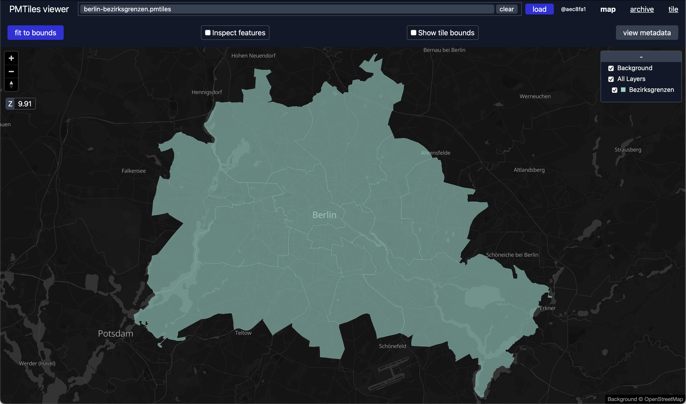
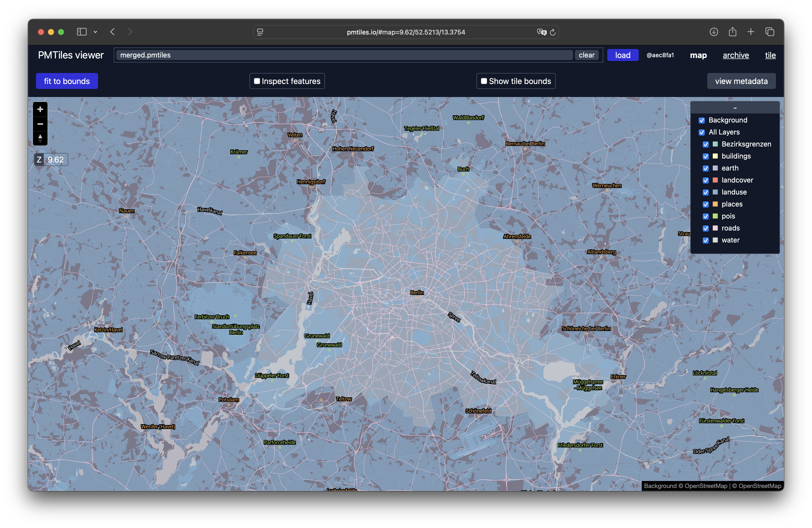

Konvertieren
============

.. _tippecanoe:

Tippecanoe
----------

`Tippecanoe <https://github.com/felt/tippecanoe>`__ erstellt Vektorkacheln,
:abbr:`u.a. (unter anderem)` aus `GeoJSON <https://geojson.org>`_- und
`FlatGeobuf <https://github.com/flatgeobuf/flatgeobuf>`_-Dateien. Ab Version
2.17 unterstützt Tippecanoe auch PMTiles mit der Option
:samp:`-o {FILENAME}.pmtiles`.

Installation
~~~~~~~~~~~~

.. tab:: Debian/Ubuntu

   .. code-block:: console

      $ sudo apt install gcc g++ git make libsqlite3-dev zlib1g-dev
      $ git clone https://github.com/felt/tippecanoe.git
      $ cd tippecanoe
      $ make -j
      $ make install

.. tab:: macOS

   .. code-block:: console

      $ brew install tippecanoe

Layer erstellen
~~~~~~~~~~~~~~~

.. code-block:: console

   $ tippecanoe -zg --projection=EPSG:4326 -o berlin-bezirksgrenzen.pmtiles -l Bezirksgrenzen berlin-bezirksgrenzen.geojson
   12 features, 141487 bytes of geometry and attributes, 823 bytes of string pool, 0 bytes of vertices, 0 bytes of nodes
   Choosing a maxzoom of -z3 for features typically 76627 feet (23356 meters) apart, and at least 9105 feet (2775 meters) apart
   Choosing a maxzoom of -z12 for resolution of about 110 feet (33 meters) within features
     99.3%  12/2198/1342

PMTiles-Dateien zusammenfügen
~~~~~~~~~~~~~~~~~~~~~~~~~~~~~

Um mehrere PMTiles-Dateien zu einer einzigen Datei zusammenzufügen, könnt ihr
`tile-join <https://github.com/felt/tippecanoe?tab=readme-ov-file#tile-join>`_
verwenden, das mit Tippecanoe mitkommt.

.. code-block:: console

   $ tile-join -o merged.pmtiles *.pmtiles -L boundaries

.. _pmtiles-cli:

pmtiles CLI
-----------

Das Kommandozeilentool `pmtiles <https://docs.protomaps.com/pmtiles/cli>`_
konvertiert :ref:`python4datascience:mbtiles` in PMTiles.

Installation
~~~~~~~~~~~~

.. code-block:: console

   $ uv add pmtiles

MBTiles konvertieren
~~~~~~~~~~~~~~~~~~~~

mit dem Befehl :samp:`pmtiles convert {INPUT}.mbtiles {OUTPUT}.pmtiles` könnt
ihr MBTiles in PMTiles konvertieren.

.. _rio-pmtiles:

rio-pmtiles
-----------

`rio-pmtiles <https://pypi.org/project/rio-pmtiles/>`__ ist ein Plugin für
`Rasterio <https://rasterio.readthedocs.io/en/stable/>`_, mit dem sich
:ref:`python4datascience:geotiff`-Dateien konvertieren lassen.

Installation
~~~~~~~~~~~~

.. code-block:: console

   $ uv add rio-pmtiles

GeoTIFF konvertieren
~~~~~~~~~~~~~~~~~~~~

Die Konvertierung zeigen wir anhand einer Datei aus den `GeoTIFF-Beispielen von
OSGeo <https://download.osgeo.org/geotiff/samples/>`_:

.. code-block:: console

   $ curl https://download.osgeo.org/geotiff/samples/usgs/c41078a1.tif --output c41078a1.tif
     % Total    % Received % Xferd  Average Speed   Time    Time     Time  Current
                                 Dload  Upload   Total   Spent    Left  Speed
   100 15.0M  100 15.0M    0     0  3757k      0  0:00:04  0:00:04 --:--:-- 3940k
   $ gdal_translate -expand rgb c41078a1.tif c41078a1_rgb.tif
   Input file size is 7202, 5593
   0...10...20...30...40...50...60...70...80...90...100 - done.
   $ uv run rio pmtiles c41078a1_rgb.tif c41078a1.pmtiles
   …
   100%|███████████████████████████████████████| 777/777 [00:07<00:00, 106.06it/s]

``gdal_translate`` konvertiert ein *single-band* in ein *3-band-RGB-GeoTIFF*.

Weitere Optionen von ``rio pmtiles`` sind:

``--format``
    erlaubt entweder ``JPEG``, ``WEBP`` oder verlustfreies ``PNG``.

    Der Standardwert ist ``WEBP``.

``--tile-size``
    gibt die Abmessungen in Pixeln an.

    Der Standardwert ist ``512``.

``--resampling``
    erlaubt die Angabe von ``nearest`` für diskrete Daten.

    Der Standardwert ist ``bilinear``.

``--silent``
    zeigt keinen Fortschrittsbalken an.
``--zoom-levels``
    erlaubt die Angabe der generierten Zoomstufen.

    Standardmäßig werden alle Stufen zwischen ``0`` und der angegebenen Stufe
    generiert, um die vollständigen Details der Eingabe zu erfassen.

``--help``
    zeigt weitere Optionen und GDAL-Flags an.

Shapefiles, PostGIS-Tabellen :abbr:`etc. (et cetera)`
-----------------------------------------------------

`GDAL <https://gdal.org/en/stable/>`_ untertützt ab Version 3.8.0 PMTiles.

Das hierfür erforderliche ``ogr2ogr`` lässt sich installieren mit

.. tab:: Debian/Ubuntu

   .. code-block:: console

      $ sudo apt install gdal-bin

.. tab:: macOS

   Die Apache Arrow-Bibliothek der aktuellen Homebrew-Distribution ist defekt.
   Um GDAL erfolgreich zu bauen, konfiguriert CMake so, dass das Arrow-Paket
   nicht gefunden wird. Ebenso wird Boost nicht mehr mit libkml gebündelt,
   weswegen libkml beim Bauen unter MacOS deaktiviert werden sollte:

   .. code-block:: console

      $ cmake -DCMAKE_DISABLE_FIND_PACKAGE_Arrow=ON ..
      $ cmake -DGDAL_USE_LIBKML=OFF ..
      $ brew install gdal

.. tab:: Spack

   .. code-block:: console

      $ spack install gdal

Anschließend könnt ihr mit ``ogr2ogr`` eine breite Palette von Formaten in
:file:`*.pmtiles`-Dateien umwandeln, :abbr:`z.B. (zum Beispiel)` `Shapefiles
<https://enterprise.arcgis.com/de/portal/latest/use/shapefiles.htm>`_ und
:doc:`python4datascience:data-processing/postgresql/postgis/index`-Tabellen:

.. code-block:: console

   $ ogr2ogr -dsco MINZOOM=10 -dsco MAXZOOM=15 -f "PMTiles" FILENAME.pmtiles MY_SHAPES.shp
   $ ogr2ogr -dsco MINZOOM=0 -dsco MAXZOOM=15 -f "PMTiles" FILENAME.pmtiles "PG:host=MY_HOST port=MY_PORT dbname=MY_DATABASE user=MY_USERNAME password=MY_PASSWORD schemas=MY_SCHEMA"

``MAXZOOM=15``
    reicht für Karten auf Straßenebene aus. Wenn ihr mit einem niedrigeren
    ``MAXZOOM``-Wert weniger Details auswählt, verringert sich die Größe der
    endgültigen Datei.

.. tip::
   ``ogr2ogr`` zur Erstellung von Vektor-PMTiles empfiehlt sich nur für kleinere
   Datensätze: :ref:`tippecanoe` erzeugt wesentlich effizienter
   Übersichtskacheln.

.. seealso::
   * `GDAL documentation
     <https://gdal.org/en/stable/drivers/vector/pmtiles.html>`_
