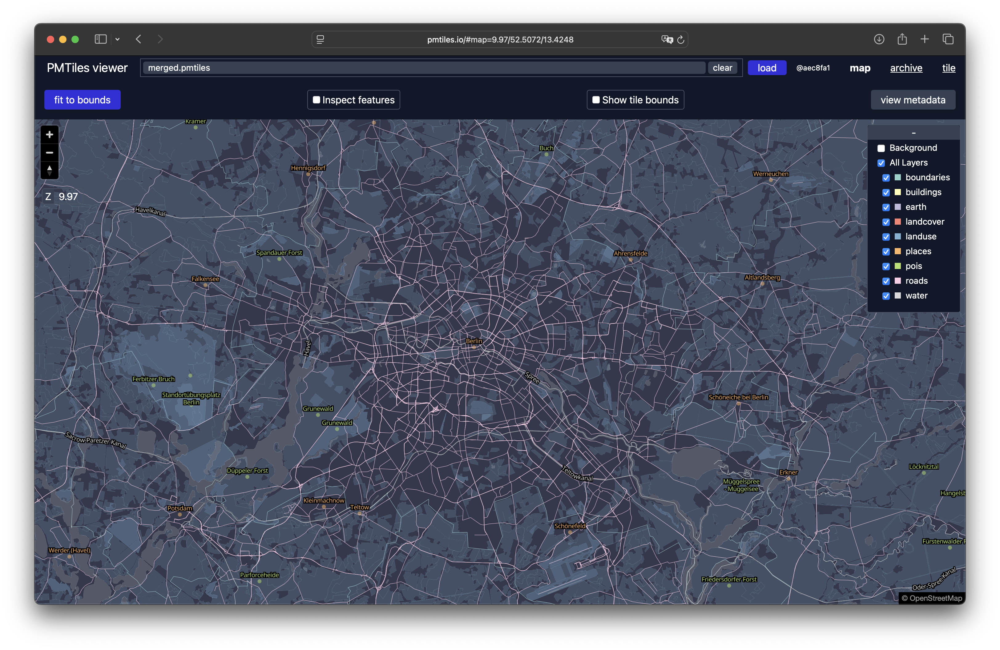

Extrahieren
===========

Zum Extrahieren von PMTiles benötigt ihr das ``pmtiles``-Kommandozeilenwerkzeug.

Installation
------------

Ihr könnt es einfach von `GitHub
<https://github.com/protomaps/go-pmtiles/releases>`_ herunterladen.
Für macOS könnt ihr alternativ auch `Homebrew <https://brew.sh>`_ verwenden:

.. code-block:: console

   $ brew install pmtiles

Metainformationen anzeigen
--------------------------

Zur Anzeige von Metainformationen einer Basiskarte in
https://maps.protomaps.com/builds könnt ihr ``pmtiles show`` verwenden:

.. code-block:: console

   $ pmtiles show https://build.protomaps.com/20261017.pmtiles
   pmtiles spec version: 3
   tile type: mvt
   bounds: (long: -180.000000, lat: -85.051129) (long: 180.000000, lat: 85.051129)
   min zoom: 0
   max zoom: 15
   center: (long: 0.000000, lat: 0.000000)
   center zoom: 0
   addressed tiles count: 1431655765
   tile entries count: 178269354
   tile contents count: 136381831
   clustered: true
   internal compression: gzip
   tile compression: gzip
   pgf:devanagari:version 1
   planetiler:githash 0e5588c4a6e8c29a270a33afe8df62027d889604
   planetiler:osm:osmosisreplicationtime 2026-10-17T04:00:00Z
   planetiler:osm:osmosisreplicationurl https://planet.osm.org/replication/hour/
   type baselayer
   version 4.15.2
   vector_layers <object, use --metadata to view full JSON metadata>
   attribution <a href="https://www.openstreetmap.org/copyright" target="_blank">&copy; OpenStreetMap</a>
   pgf:devanagari:name NotoSansDevanagari-Regular
   planetiler:buildtime 2026-03-28T14:41:39.524Z
   planetiler:osm:osmosisreplicationseq 123549
   planetiler:version 0.10.2
   description Basemap layers derived from OpenStreetMap and Natural Earth
   name Protomaps Basemap
   web viewer: https://pmtiles.io/#url=https%3A%2F%2Fbuild.protomaps.com%2F20261017.pmtiles

Bereich extrahieren
-------------------

Wir können eine Teilmenge der Planetendatei :file:`berlin.pmtiles` erstellen,
die nur Kacheln enthält, die einer entsprechenden *Bounding Box* entsprechen.

.. tip::
   Die Begrenzungsrahmen eures Bereichs könnt ihr :abbr:`z. B. (zum Beispiel)`
   mit `bboxfinder.com <https://bboxfinder.com/>`_ ermitteln.

.. code-block:: console

   $ pmtiles extract https://build.protomaps.com/20261018.pmtiles berlin.pmtiles --bbox="13.088348,52.338245,13.761159,52.675508"
   2026/10/18 22:39:14 extract.go:401: fetching 9 dirs, 9 chunks, 8 requests
   2026/10/18 22:39:18 extract.go:441: Region tiles 4337, result tile entries 4337
   2026/10/18 22:39:18 extract.go:450: fetching 4337 tiles, 152 chunks, 49 requests
   fetching chunks 100% |██████████████████████████| (81/81 MB, 5.4 MB/s)
   2026/10/18 22:39:33 extract.go:606: Completed in 20.2353935s with 4 download threads (214.32743441381908 tiles/s).
   2026/10/18 22:39:33 extract.go:611: Extract required 60 total requests.
   2026/10/18 22:39:33 extract.go:612: Extract transferred 85 MB (overfetch 0.05) for an archive size of 81 MB

Alternativ können wir den Begrenzungsrahmen auch aus einer GeoJSON-Datei
extrahieren:

.. code-block:: console

   $ curl https://tsb-opendata.s3.eu-central-1.amazonaws.com/bezirksgrenzen/bezirksgrenzen.geojson --output berlin.geojson
   $ pmtiles extract https://build.protomaps.com/20261018.pmtiles berlin.pmtiles --region="berlin-bezirksgrenzen.geojson"
   2026/10/18 22:36:11 extract.go:401: fetching 9 dirs, 9 chunks, 8 requests
   2026/10/18 22:36:17 extract.go:441: Region tiles 2481, result tile entries 2481
   2026/10/18 22:36:17 extract.go:450: fetching 2481 tiles, 146 chunks, 55 requests
   fetching chunks 100% |██████████████████████████| (65/65 MB, 3.2 MB/s)
   2026/10/18 22:36:38 extract.go:606: Completed in 27.302503541s with 4 download threads (90.8707870360268 tiles/s).
   2026/10/18 22:36:38 extract.go:611: Extract required 66 total requests.
   2026/10/18 22:36:38 extract.go:612: Extract transferred 68 MB (overfetch 0.05) for an archive size of 65 MB

Wir können auch nur die Zoomstufen ``0`` bis ``12`` und damit eine kleinere
Datei herunterladen:

.. code-block:: console

   $ pmtiles extract https://build.protomaps.com/20261018.pmtiles berlin.pmtiles --region="berlin-bezirksgrenzen.geojson" --maxzoom 12
   2026/10/18 22:34:31 extract.go:401: fetching 5 dirs, 5 chunks, 5 requests
   2026/10/18 22:34:34 extract.go:441: Region tiles 77, result tile entries 77
   2026/10/18 22:34:34 extract.go:450: fetching 77 tiles, 25 chunks, 20 requests
   fetching chunks 100% |█████████████████████████| (6.0/6.0 MB, 1.5 MB/s)
   2026/10/18 22:34:38 extract.go:606: Completed in 11.696528958s with 4 download threads (6.5831495118856465 tiles/s).
   2026/10/18 22:34:38 extract.go:611: Extract required 28 total requests.
   2026/10/18 22:34:38 extract.go:612: Extract transferred 6.3 MB (overfetch 0.05) for an archive size of 6.0 MB

Ansicht der Basiskarte
----------------------

`pmtiles.io <https://pmtiles.io/>`_ ist ein Viewer für Basiskarten. Klickt auf
:guilabel:`Datei auswählen` und wählt dann die Datei :file:`berlin.pmtiles` aus:

